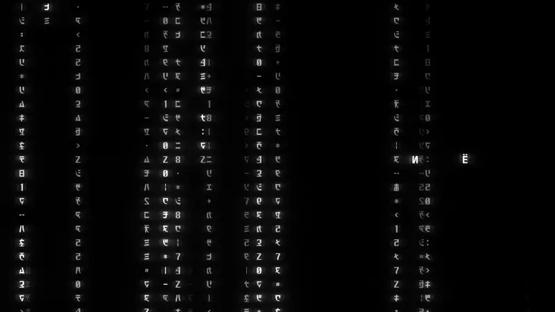
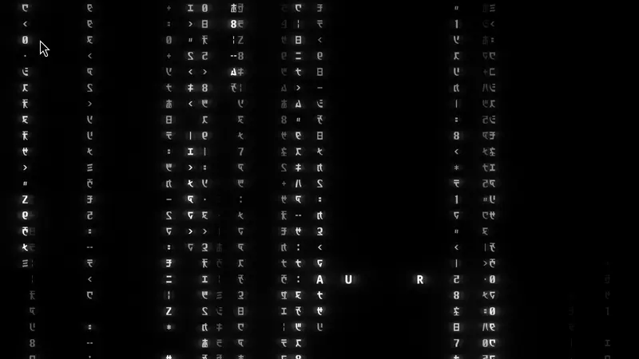
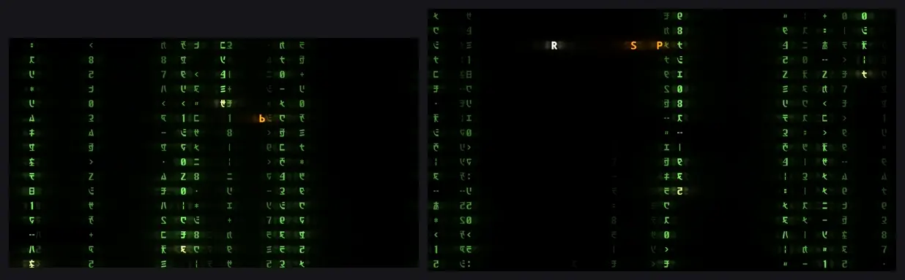

[Русская версия](README.ru.md)

# matrix-news-viewer



A live wallpaper for Wayland compositors with the layer-shell protocol
(Hyprland, Sway, river, niri). Vertical Matrix rain covers all monitors as one
scene. Headlines from a newsboat cache appear inside the rain; a click on a
headline rains in the first paragraph of the item, a double click opens its
link. The idea comes from
[HelpFreedom/matrix-rain-saver](https://github.com/HelpFreedom/matrix-rain-saver);
this is a separate program, not a fork.

The program never goes to the network. News arrive only when you run
`newsboat -x reload`.

## Demo

A click on a headline rains in the first paragraph of the item:



Two monitors of different sizes show one scene; density and speed change live:



The news here are fake. `demo/record.py` records these clips on a headless sway from `demo/news.sql`.

## Install

```
pacman -S newsboat
cargo install --path . --root ~/.local
mkdir -p ~/.config/newsboat ~/.config/matrix-news-viewer
cp newsboat-urls.example ~/.config/newsboat/urls
cp config.example.toml ~/.config/matrix-news-viewer/config.toml
newsboat -x reload
matrix-news-viewer
```

## Config

`~/.config/matrix-news-viewer/config.toml`. Every key is optional; see
`config.example.toml`. The program reloads the file when it changes.

The palette preset `theme` reads `~/.config/matrix-news-viewer/theme.toml`
(`rain`, `cursor`, `text`, `background` as `"#rrggbb"`), so a theme switcher
can recolour the rain live.

Single keys can be read and written from scripts, keeping comments in the file:

```
matrix-news-viewer get rain.fall_speed
matrix-news-viewer set rain.density 0.3
```

## Credits

Glyph atlas and rain shaders: [Rezmason/matrix](https://github.com/Rezmason/matrix),
MIT, see `assets/LICENSE-matrix`. The multi-monitor world crop and the headline
animation follow the design of
[HelpFreedom/matrix-rain-saver](https://github.com/HelpFreedom/matrix-rain-saver),
reimplemented from its description.

## License

GPL-3.0. The files taken from Rezmason/matrix keep their MIT license.
